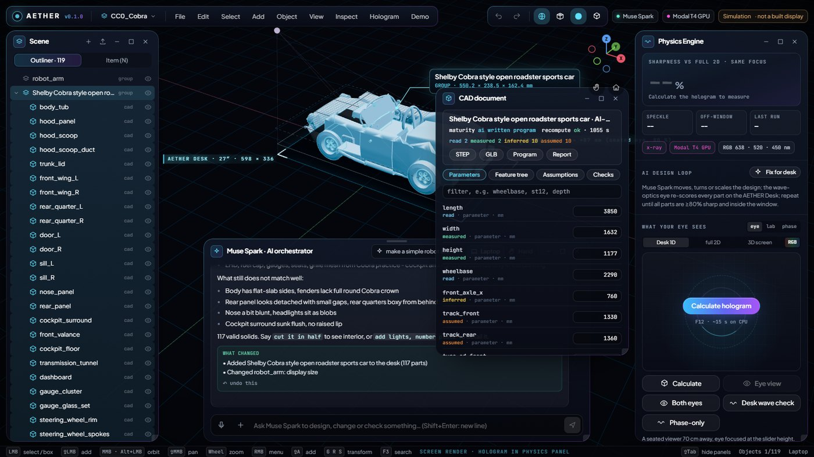
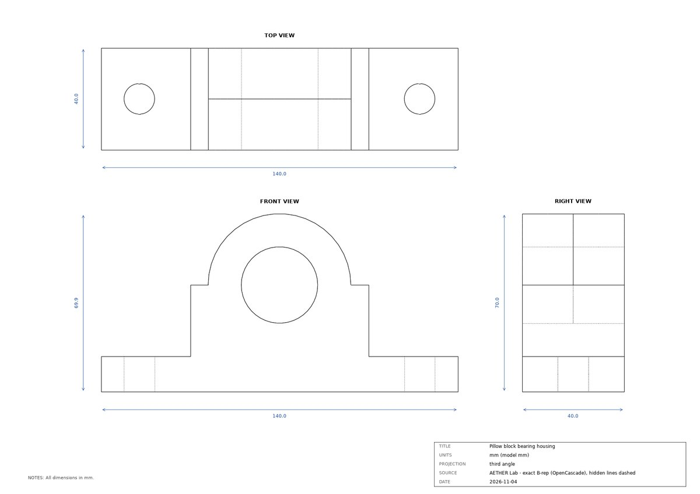
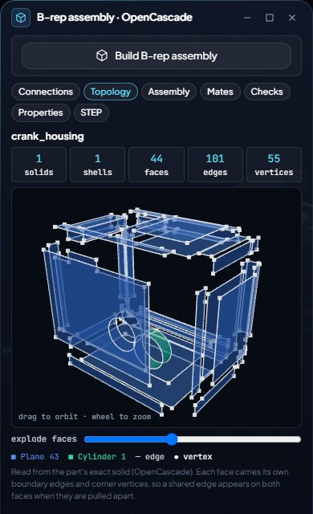
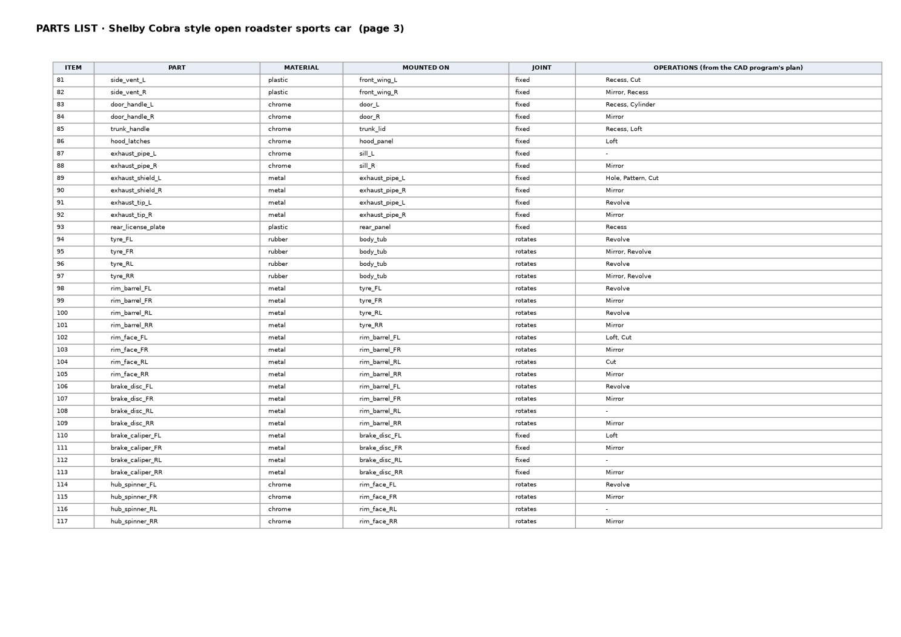
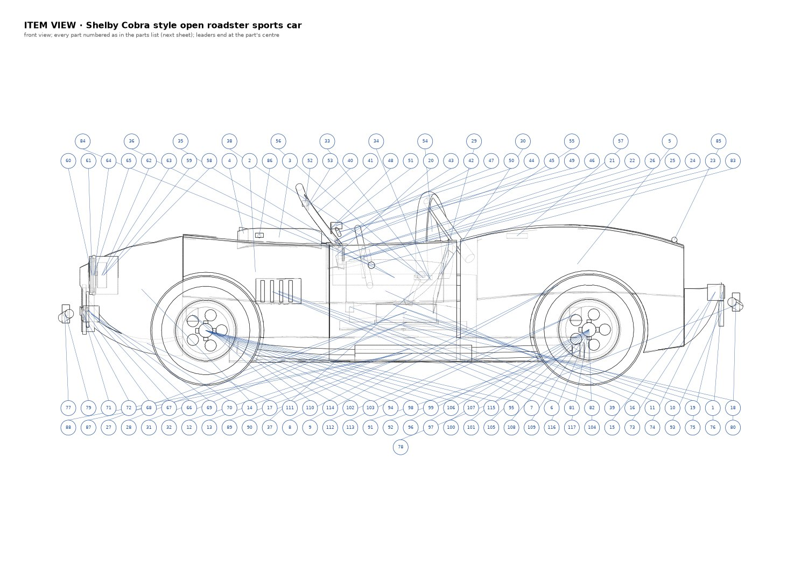

# AETHER Lab

### Old machine drawings in, editable engineering CAD out, and it tells you what it had to guess.

**Meta Global AI Developer Hackathon 2026 · Indie Developer track · Theme: Push the Frontier · Ng Wei Bin (solo)**

▶ **[3-minute demo video](#)** _(link added on submission)_ &nbsp;·&nbsp;
🔍 **[Hosted replay, no setup](https://aether-lab-delta.vercel.app/replay.html)** &nbsp;·&nbsp;
📏 **[Ground truth](aether-lab/docs/GROUND_TRUTH.md)** &nbsp;·&nbsp;
✅ **[Acceptance tests](aether-lab/docs/ACCEPTANCE.md)** &nbsp;·&nbsp;
🧾 **[Provenance](AETHER_HACKATHON_PROVENANCE.md)**



---

## The problem

Factories, museums and repair shops keep machines running for which **no CAD exists**: only a patent figure, a
faded catalogue page or a three-view sketch. One view, no scale, hidden parts, and the maker long gone. Today an
engineer redraws such a machine by hand, and nothing records which dimensions were read off the paper and which
were guessed.

## What AETHER Lab does

You give it a drawing (or a description). Meta's models plan the machine and **write the CAD program themselves**;
AETHER's own code runs it, checks it and keeps every number honest.

| Step | Who does it | What happens |
|---|---|---|
| 1. Check the drawing | **Muse Spark** | Reads the sheet like an engineer taking a job: which views it shows, what is missing, the one question worth asking |
| 2. Plan the machine | **Muse Wonder** | Every component with what it is mounted on, its joint (fixed / turns / slides), its evidence on the drawing, and the **unknowns**: what the drawing cannot tell |
| 3. Write the CAD | **Muse Wonder** | A CadQuery / OpenCascade program, key sizes as named parameters (`measured`, `read`, `inferred`, `assumed`) |
| 4. Build and check | **AETHER code** on Modal CPU | Sandboxed run; every solid validated by OpenCascade; quality gates (floating parts, parts passing through each other, mechanical constraints); each view compared with the drawing |
| 5. Critique and revise | **Muse Spark** + renders | Looks at real renders, scores them, and Muse Wonder rewrites the program; the best *checked* round is kept |
| 6. Keep engineering | **Muse Spark** orchestrator, 40 tools | "the bore is 30 mm", "explain how it works", "make a technical drawing", "check interference", "export STEP": by chat or by voice (**Muse Voice Transcribe**); a part from a phone photo via **SAM 3.1** |

**Models propose, code decides.** No measured value comes from a model, and every guess is labelled as a guess.

## Proof: does the CAD match the real part?

Three parts with **known dimensions** were drawn as engineering drawings. AETHER got only the drawing, then its
solids were measured against the known ones ([full table and method](aether-lab/docs/GROUND_TRUTH.md)):

| | Pillow block | Flanged hub | Gusset bracket |
|---|---|---|---|
| **Muse Wonder alone, one shot** (no plan, checks or critic) | ❌ program crashed, no solid | sizes exact · hub Ø **+6 mm**, bore +3 mm | sizes exact · **0 of 4 holes** |
| **AETHER loop** | ✅ valid · sizes within 0.1 mm · bore +4 mm (marked *inferred*) | sizes exact · hub Ø +5 mm | sizes exact · holes +3 mm |
| **+ engineer corrects the *inferred* values** (≈10 s, no AI call) | ✅ **every diameter exact**, IoU 0.95 / 1.00 / 0.99 | hub exact · bore still under size (a limitation it exposed) | ✅ **all 4 holes exact** |

What this shows:
- **Sizes written on the drawing come out exact.**
- **Sizes it had to scale are a few mm off, and each one is marked *inferred*.** The engineer knows exactly what to measure.
- **Correcting them re-runs the same program in about 10 seconds**, and the error goes to zero.

<p align="center">
  
  
</p>

## A 1909 patent, one view, no scale

US Patent 929,594 shows a metal drawing press in **one sectional view**. AETHER builds it as **67 exact solids**,
lists what one view cannot tell (the depth, the real scale, the drive train behind the cover, the blade cut off
the sheet), and its own checks improve the model within one run ([CAD quality](aether-lab/docs/CAD_QUALITY.md)):

| Within one run | Round 1 | Kept round |
|---|---|---|
| Parts passing through each other | 35 | **2** |
| Plain boxes | 39 % | **0 %** |
| Failed mechanical constraints | 11 | **0 of 28** |
| Critic score | 2 / 10 | **5 / 10** |

## An engineer's toolkit, not a 3D picture

- **Exact B-rep and STEP.** Every part is an OpenCascade solid and the STEP opens in any CAD system.
- **B-rep assembly check.** Every pair of parts is tested for contact and interference; the roadster has 117 parts, all 117 valid.
- **Connection diagram.** What is mounted on what, with which joint, and whether the geometry confirms it.
- **B-rep topology.** Any part pulled apart into its real faces, edges and vertices.
- **CAD feature tree.** Parts nested by mounting, each with its operations (loft, split, fillet, recess…).
- **Assembly drawing.** Three views with dimensions, an item view with numbered balloons, a parts list (material, mounted on, joint, operations) and the connection diagram, in one PDF.
- **Explain this machine.** Step by step along the real connections ("the nose panel is fixed on the tub; the headlight housing is fixed on the nose…"); every part and number is checked against the model.
- **Inspect.** Section cuts, X-ray, explode, isolate, measure, mass properties.
- **Corrections without an AI call.** Fix a parameter and the same program re-runs.
- **Edits by chat are checked.** Only the parts concerned may change; the requested relation (e.g. "the glass touches the frame") is verified on the geometry; anything else that moved is reported.

<p align="center">
  
  
</p>

## Meta models, and what each one decides

| Model | Role in AETHER Lab |
|---|---|
| **Muse Wonder** (`muse-wonder-1.0`) | Plans every component (parent, joint, evidence, unknowns) and **writes and revises the CAD program**; plans edits as the smallest change |
| **Muse Spark** (`muse-spark-1.3`) | Orchestrates every chat turn across 40 tools; checks a drawing before a build; **critiques real renders**; judges whether an edit was achieved; writes grounded explanations |
| **SAM 3.1** (`sam-3.1`) | Cuts a part out of a phone photo for a model of it |
| **Muse Voice Transcribe** (`muse-voice-transcribe-1.0`) | Hold-to-talk commands |

Every step in the chat shows which model or engine did it and how long it took, live, including the cloud CAD jobs.

## Honest limits

- **These are engineering drafts, not certified CAD.** Complex machines score 2–5 out of 10 with the critic.
- **The ground truth is synthetic:** drawings made from known models, not yet real measured parts.
- **One view cannot show depth.** Hidden geometry is inferred, and labelled as inferred.
- **Real scale is assumed** until a dimension is given or read.
- **Muse Wonder sometimes models a feature wrongly**, for example holes filled with "liner" solids, and not every such case is caught yet.
- **There is no general motion solver.**

## Try it

**No setup:** the [hosted replay](https://aether-lab-delta.vercel.app/replay.html) shows recorded runs, each
labelled "RECORDED · not live".

**Run it** (Windows, Python 3.12, a Meta Model API key):

```bash
cd aether-lab
cad-worker\setup.ps1                  # once: the pinned CadQuery / OpenCascade environment
#   put META_API=... in .env (repository root)
python -m modal deploy modal_cad.py   # optional: CAD jobs on Modal CPU (needs the Modal secret aether-meta)
start.bat                             # opens http://localhost:8765 when the lab is ready
```

**Check the numbers:**
- Offline tests, no key: `cad-worker\.venv\Scripts\python -m pytest tests/test_physics.py` (32 pass).
- Ground truth: `tests/ground_truth/` (scripts and saved results).
- Acceptance tests: `python -m tests.acceptance_ai` (14 scenarios through the chat API).

## Where things are

```
aether-lab/                 the hackathon product
  cad/                      AI-written CAD loop (codegen.py), quality gates, assembly, drawings, topology
  prompts/                  the instruction files Muse Wonder and the critic work from
  assistant.py              Muse Spark orchestrator and its 40 tools
  server.py, ui/            local server and React / three.js app
  modal_cad.py              the CAD loop on Modal CPU (one container per job, cancellable)
  tests/                    ground truth, acceptance, quality benchmark, physics tests
  docs/                     evidence, results, replay site (start at docs/README.md)
theory/, references/        background research for the long-term vision (see provenance)
```

**The long-term vision**, AETHER started as research toward a no-headset holographic workbench; the wave-optics
simulator is in `aether-lab/engine/`. All of it is simulation, and no display has been built. See
[AETHER_LONG_TERM_PROPOSAL.md](AETHER_LONG_TERM_PROPOSAL.md).

Inputs are public-domain patent drawings, NASA graphics and a CC0 car sheet ([INPUTS.md](aether-lab/docs/INPUTS.md)).
NASA does not endorse this project. MIT licence ([aether-lab/LICENSE](aether-lab/LICENSE)).
