# AETHER Physics Record

**Every physics, optics, materials and energy study done in Project AETHER, in the order we did it, with derivations, numbers, simulations and the reasons behind each decision.**

Ng Wei Bin · 23–26 October 2026 · living document
Simulation code, raw results and figures: [`simulations/`](simulations/) (all runnable with `python3`, needs numpy, scipy, matplotlib)

---

## How to read this record

The project began with one question: *can a bank-card-sized device put a 3D image into empty air that people can see and touch?* We answered it the hard way. We started from the equations that govern light, derived what is and is not allowed, simulated the numbers, compared them with real products, and threw away every design that broke a law or one of the founder's requirements. Each time we hit a wall we wrote down the hidden assumption behind it and attacked that assumption.

Dropped directions stay in this record as history, so the reader can see why the current direction is the one left standing. They are not proposals.

**Evidence labels**

| Label | Meaning |
| --- | --- |
| **Derived** | Follows mathematically from the stated physics |
| **Simulated** | Computed by one of our Python models in `simulations/` |
| **Estimate** | Order-of-magnitude with stated assumptions |
| **Assumed** | A placeholder value chosen to locate a bottleneck, not a measured quantity |
| **Unverified** | Quoted from memory; must be checked against the original source before citing |

The companion files are `proposal/AETHER_Decision_Log.md` (who decided what, costs and rejections, in time order) and `references/AETHER_References.md` (every source with links).

---

## Contents

0. The journey on one page
1. Ground rules: what "seeing a point in the air" means
2. Stage 1 (23 Oct): limits of any card-sized display
3. Stage 2 (23 Oct): the eye-tracked card light field, AETHER-1
4. Stage 3 (24 Oct): attacking five bottlenecks
5. Stage 4 (24 Oct): our laws against Looking Glass and Sony
6. Stage 5 (25 Oct): the card phone and the reciprocal aperture (v2.0–v2.4)
7. Stage 6 (25 Oct): a human-size image in the room
8. Stage 7 (25 Oct, current): true holography from the wave equation
9. Everything we ruled out, in one table
10. Where we stand
11. Simulation index and how to reproduce
12. Open questions and the next calculations

---

## 0. The journey on one page

| Date | Stage | Question | Outcome | What forced the next step |
| --- | --- | --- | --- | --- |
| 23 Oct | 1 | Can clean air show a 3D point at all? | No. Theorems 1–2: a point needs matter there, nonlinear air, or light arriving from an aperture behind it. Seven mechanisms ruled out with numbers. | Only "aperture" images survive → design the best aperture display |
| 23 Oct | 2 | Best display within those limits? | Eye-tracked light field (AETHER-1); Theorem 3 lets us factor the light field and cut emitters ~20× | Float limited to ~43 mm; view angle ±25°; 2 viewers |
| 24 Oct | 3 | Can we push float, angle, brightness, viewers, heat? | Theorems 4–5; ±50° view; 63–82 mm float; no new physics beats the aperture theorem | Check against real products |
| 24 Oct | 4 | Do Looking Glass and Sony break our laws? | No. All confirmed; one new risk (LCD speed) | Founder redefines the product |
| 25 Oct | 5 | Can the card replace a phone with one opening and no cameras? | Reciprocal aperture; Theorems 5′–10; battery and camera laws | Founder: "this is a screen, not a hologram" |
| 25 Oct | 6 | Can a card put a human-size image in the room? | Mist, dye, film and plasma all worked out and rejected | New rule: nothing released into the air; no old ideas |
| 25 Oct | 7 | Can a *true hologram* fill a room? | H1 Window Law; superoscillation and H3 close the optical workarounds; only "air emits light" remains open | Screening shows the bottleneck is a molecular pathway |

---

## 1. Ground rules: what "seeing a point in the air" means

The founder asked us to ignore existing projector designs and reason from physics only, "like Newton before *Principia*". We therefore started from the radiative transfer equation, which is geometric optics plus energy conservation and contains no technology assumptions. Along a ray arriving at the eye, the radiance L changes as

$$\frac{dL}{ds} = -(\kappa+\beta)L + \kappa B + \beta\int p(\Omega,\Omega')L(\Omega')\,d\Omega' + j_{NL}(I)$$

The four terms are absorption and scattering loss, thermal emission, light scattered into the ray from other directions, and nonlinear (intensity-dependent) emission such as breakdown. **Derived:** a point P in space can be seen in only three ways.

1. **A local source at P.** Matter at P scatters or emits, or the air at P responds nonlinearly (κ, β or j_NL non-zero at P).
2. **Light passing through P.** Nothing is generated at P; the light comes along the same line from a surface behind P and merely converges there. This is a real image.
3. **Changing the optical properties of the air** so the air itself becomes a lens or grating.

Every mechanism in this record belongs to one of these classes. In stage 7 we restate the same idea with wave optics: (1) and (3) become "the medium is nonlinear or active", (2) becomes "the field is radiated by the device".

---

## 2. Stage 1 (23 Oct): limits of any card-sized display

Script: `simulations/aether_sim.py` → `results.json`, figures `fig2`–`fig5`.

### 2.1 Theorem 1: clean air does not show images (Derived, Simulated)

**Rayleigh scattering.** For air at 532 nm (N = 2.547 × 10²⁵ m⁻³, n − 1 = 2.78 × 10⁻⁴, King factor 1.05):

$$\sigma = \frac{24\pi^3}{\lambda^4 N^2}\left(\frac{n^2-1}{n^2+2}\right)^2 F_K = 5.2\times10^{-31}\ \mathrm{m^2},\qquad \beta = N\sigma = 1.3\times10^{-5}\ \mathrm{m^{-1}}$$

A photon travels on average 76 km before it scatters. A 0.5 mm voxel scatters 6.6 × 10⁻⁹ of the light passing through it. Viewed from the side at 90°, a 0.5 mm beam gives 0.94 cd/m² per watt, so reaching a readable 100 cd/m² needs a ~106 W beam (enough to ignite paper).

**Localisation.** Linear scattering is equally bright everywhere along the beam, so the eye sees a line, not a point. If M beams cross, the crossing is only M times brighter than each line. **A point-like voxel therefore requires a response ∝ Iⁿ with n ≥ 2, or matter present only at that voxel.**

**Other linear and quantum channels.** Photon–photon scattering (QED, ~10⁻⁶⁷ m²) is 36 orders of magnitude below Rayleigh. Raman scattering is ~1000× weaker than Rayleigh and still linear. Two-photon fluorescence and four-wave mixing in N₂/O₂ need ultraviolet transitions and intensities comparable to femtosecond breakdown.

**Why a wall works and air does not:** a wall's β is effectively infinite at its surface; air's β is 1.3 × 10⁻⁵ m⁻¹.

### 2.2 Theorem 2: the aperture cone (Derived, Simulated)

If there is no matter at P, light travels in a straight line between P and the eye. Extending that line backwards, it must hit the device's emitting aperture, whatever optics the device contains. For a point at height h above a card of short side W, viewed at angle θ from the normal:

$$\tan\theta \le \frac{W/2}{h}$$

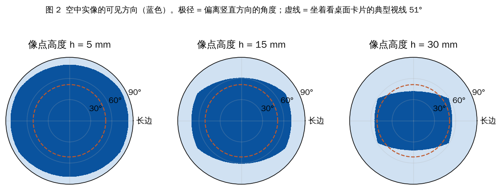

| Float height h | Short-axis half-angle | Long-axis half-angle | Share of upper hemisphere |
| --- | --- | --- | --- |
| 5 mm | 79.5° | 83.3° | 86 % |
| 15 mm | 60.9° | 70.7° | 62 % |
| 30 mm | 42.0° | 55.0° | 37 % |

A person seated at a table looks at a flat card at about 51° from vertical, which is inside the cone at h = 15 mm. **Corollary:** "produced by a card, nothing in the air, visible from all 360° horizontally" cannot all hold at once. A finger between the card and the image blocks the rays that form the part of the image "behind" it.

### 2.3 Voxel floor from diffraction (Derived)

A converging-ray image formed by lenslets of pitch p with angular sampling Δθ blurs as

$$\delta(h) \approx \sqrt{p^2 + h^2\Delta\theta^2 + h^2(\lambda/p)^2}$$

Minimising over p gives p_opt = √(λh) and **δ_min = √(2λh)**: 0.18 mm at h = 30 mm. The higher the image floats, the coarser the finest detail, regardless of hardware.

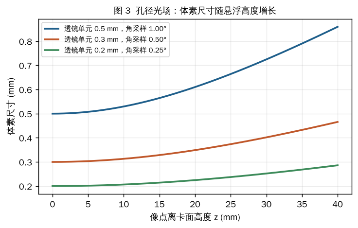

### 2.4 Pixel budget and the eye-tracking shortcut (Simulated)

| Design (±45° field, 60 Hz, 24-bit) | Sub-pixel pitch | Sub-pixels | Voxel at 30 mm | Raw data rate | Rays per pupil at 50 cm |
| --- | --- | --- | --- | --- | --- |
| p = 0.5 mm, Δθ = 1° | 5.6 µm | 1.5 × 10⁸ | 0.72 mm | 0.22 Tb/s | 0.46 |
| p = 0.3 mm, Δθ = 0.5° | 1.7 µm | 1.7 × 10⁹ | 0.40 mm | 2.4 Tb/s | 0.92 |
| p = 0.2 mm, Δθ = 0.25° | 0.56 µm | 1.5 × 10¹⁰ | 0.25 mm | 22 Tb/s | 1.8 |
| Coherent hologram, ±45° | 0.38 µm | 3.3 × 10¹⁰ | — | — | — |

At least two rays per pupil are needed for real focus cues, so the first row gives correct stereo and motion parallax but incomplete focus. The data rate looks impossible, but only a few eyes are in the room: tracking pupils means each lenslet only lights the 1–2 sub-pixels aimed at a pupil (active fraction ~1.2 × 10⁻⁴), cutting drive bandwidth, compute and optical power by about four orders of magnitude.

### 2.5 Mechanisms ruled out in stage 1

| Mechanism | Class | Numbers | Why it failed |
| --- | --- | --- | --- |
| Femtosecond air breakdown (plasma) | 1 (nonlinear) | ~10¹⁴ W/cm²; 5 µm focus, 100 fs → 7.9 µJ per pulse; 2000 voxels × 20 fps → 0.31 W average, ~785× the Class 1 limit | Eye safety, skin burns at focus, acoustic crack per voxel, ozone/NOx, laser size and few-percent efficiency |
| Ultrasound or heat as an air lens | 3 | 5 kPa → Δn = 1.4 × 10⁻⁵; deflection ≤ λ_light/Λ_sound: 6 × 10⁻⁵ rad (40 kHz), 3 × 10⁻⁴ (200 kHz), 1.6 × 10⁻³ (1 MHz, >150 dB/m absorption); need ~1 rad | The sound wavelength is 10³–10⁴ × the light wavelength; heat is worse (dn/dT ~10⁻⁶/K, diffuses) |
| Electrostatic / magnetic levitation of particles | 1 | Earnshaw: no stable static trap; diamagnetic needs B·∇B ~10²–10³ T²/m | Needs enclosing electrodes (a screen) or works only mm from a magnet |
| Optical levitation | 1 | 3.3 nN per watt vs 0.5 µN bead → hundreds of watts; photophoresis needs 0.1–1 W visible (Class 3B/4) | Unsafe for consumers |
| Mist / fog screen | 1 | — | Consumable matter that drifts; kept only as a lab control (revisited in stage 6) |
| Card-scale coherent hologram | 2 | 0.38 µm pixels, 3.3 × 10¹⁰ at 60 Hz vs ~10⁷ at 3–4 µm today | Space-bandwidth product ~1000× short (revisited in stage 7) |

### 2.6 Acoustic levitation: the only safe "matter at P" (Simulated)

Gor'kov potential for a small sphere in a standing field:

$$U = V\left[f_1\frac{\langle p^2\rangle}{2\rho_0c_0^2} - \frac34 f_2\,\rho_0\langle v^2\rangle\right],\qquad F = -\nabla U$$

Model: 8 × 5 transducers at 40 kHz on the card (10 mm pitch, source strength 8 Pa·m **Assumed** from typical datasheets), half the array in antiphase (twin trap), 1.5 mm expanded-polystyrene bead (53 µg).

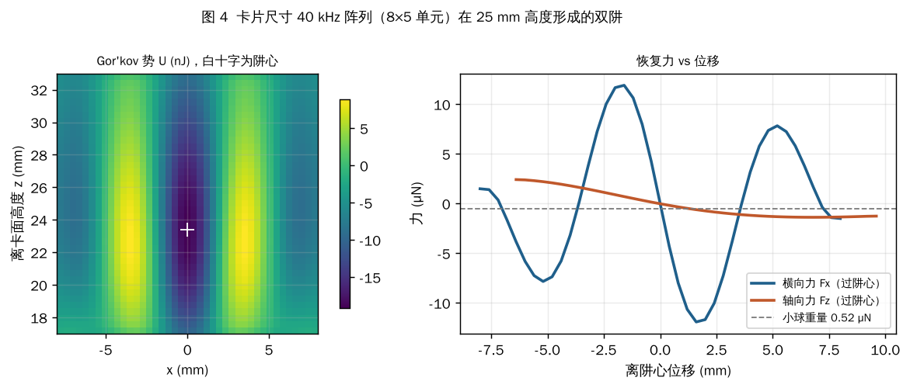

| Quantity | Value |
| --- | --- |
| Trap height | 23.4 mm |
| Peak pressure | 3.6 kPa (162 dB) |
| Lateral restoring force | 11.9 µN = 23× weight |
| Axial restoring force | 1.4 µN = 2.6× weight (weak axis) |
| Speed on a 10 mm-radius path (40 % margin) | 0.95 m/s |
| Voxels per frame at 20 fps | ~50 per bead, ~200 with 4 beads |
| Acoustic power | 0.093 W per element, 3.7 W total |
| Electrical power at 20 % efficiency (**Assumed**) | ~19 W |
| Light to illuminate the bead (2 % duty, 5000 cd/m²) | ~0.4 mW |

**Scaling law (Derived):** Gor'kov force ∝ p²r³ and weight ∝ ρr³, so force/weight is independent of bead size; acceleration ∝ p² ∝ acoustic power, and on a curved path v = √(aR), so **voxel refresh rate ∝ √(acoustic power)**. Doubling the voxel count costs 4× the power.

Air absorption is small at card scale (ISO 9613-1, 20 °C, 50 % RH): <1 dB over 5 cm even at 300 kHz, which would allow ~6000 PMUT elements at 200 kHz in a later generation.

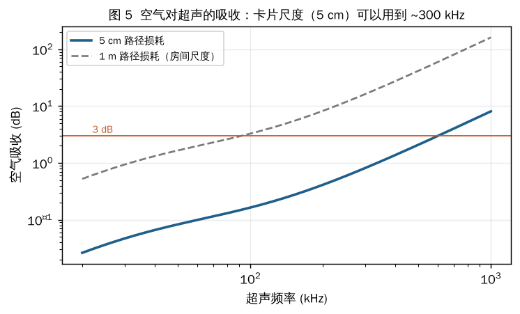

**Verdict:** truly visible from every direction, and the same field can give fingertip haptics, but ~19 W against a ~2.2 W card limit. At most a plug-in dock accessory. 162 dB at the focus also needs an ear-safety check (occupational guidance near 40 kHz is ~110 dB).

### 2.7 Thermal and brightness budget (Estimate, Simulated)

Card area including 8 mm edges ≈ 115 cm². Natural convection plus radiation h ≈ 12.5 W/m²K (**Assumed**). Sustained power at a skin-temperature rise of 10 / 15 / 20 K: **1.43 / 2.15 / 2.87 W.** A 4 mm lithium cell (~12 Wh) would last ~6 h at 2 W. The heat ceiling arrives before the battery limit, so large AI models must run on a phone or in the cloud.

| Stage-1 power allocation (Estimate) | Power |
| --- | --- |
| Light-field emission, eye-tracked, 300 cd/m² | < 0.01 W |
| Backplane drive, 1.5 × 10⁸ sub-pixels, sparse | 0.4–0.6 W |
| Two IR cameras + IR illumination | 0.3 W |
| Tracking and ray rendering (NPU/ISP) | 0.6–0.8 W |
| Wireless (AI external) | 0.2 W |
| **Total** | **1.5–1.9 W** |
| Without eye tracking (light into whole ±50° cone) | emission 0.07 W |
| Acoustic levitation mode | ~19 W (mains only) |

Brightness is not limited by "how much air there is": real-image luminance equals source radiance × optical efficiency, and microLED reaches 10⁵–10⁶ cd/m².

### 2.8 Stage-1 validation plan (proposed, not executed)

| ID | Test | Pass criterion |
| --- | --- | --- |
| V0 | 1 mW green laser through clean air vs light smoke | Clean-air beam below camera noise; crossing two beams ≈ 2× one beam (linear, no localisation) |
| V1 | Tablet (~500 ppi) + 1 mm microlens array; points at 5/15/30 mm | Cone within 5° of Fig. 2; blur within 30 % of δ(h); depth within 2 mm |
| V2 | Eye-tracked sparse rendering, two viewers | Correct views each; < 1 % pixels lit; < 20 ms latency |
| V3 | 8 × 5 40 kHz array + foam bead | Trap 23 ± 3 mm; escape speed within 2× of 0.95 m/s; measure real power and SPL at 40 cm |
| V4 | IR fingertip tracking registered to the light field | < 1 mm registration; < 30 ms latency |
| V5 | Wafer-scale microLED partner | Spec sheet backed by V1–V4 data |

**Honest note from stage 1:** reasoning from physics alone converged on two known principles, integral imaging (Lippmann, 1908) and acoustic levitation. That is evidence they are physically right answers, not that they are new.

---

## 3. Stage 2 (23 Oct): the eye-tracked card light field, AETHER-1

Script: `simulations/aether_mp_sim.py` → `results_mp.json`, figures `mp_*`. The founder asked for one complete, mass-producible plan written against their original 15-section charter template (systems A–G), not interim reports.

### 3.1 Theorem 3: depth-of-focus equivalence (Derived, Simulated)

Sending each eye its correct rays differs from a true converging light field only in where the eye *focuses*: on the card plane instead of on the floating point. The mismatch in dioptres is

$$\Delta D = \frac{1}{d-h} - \frac1d \quad\Rightarrow\quad h \le \frac{0.3\,d^2}{1+0.3\,d}\ \ (d\ \text{in m, eye depth of field} \pm0.3\ \mathrm D)$$

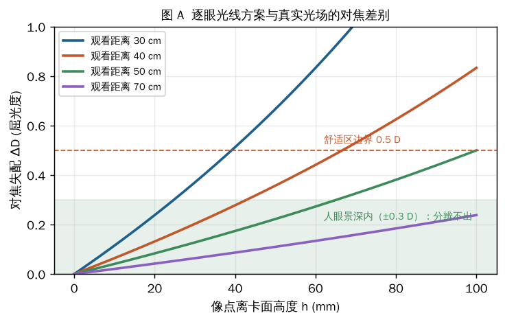

| Viewing distance | 30 cm | 40 cm | 50 cm | 70 cm |
| --- | --- | --- | --- | --- |
| Max float at 0.3 D | 25 mm | 43 mm | 65 mm | 121 mm |
| Max float at 0.5 D | 39 mm | 67 mm | 100 mm | 181 mm |

**Consequence:** within these heights the eye cannot tell per-eye rays from a true light field, so the 4D light field can be factored:

> emitted field = image layer (x, y, t) × direction layer (x, y, θ, φ, t), with the tracked eye position as the third factor.

That turns the 1.5 × 10⁸-emitter problem into **7.4 million direction emitters plus a 0.46 MP colour LCD.**

### 3.2 Lens and steering design (Simulated)

Ray-tracing a 1.0 mm lenslet (R = 0.51 mm) showed a spherical surface spreads each beam to ~10° (80 % energy width). An asphere with conic k = −0.2 halves this to 4.9–6.7° across ±25° steering, keeping the other eye (63 mm away at 50 cm) clear with an 8 mm margin. Head motion of 0.3–0.6 m/s allows 13–27 ms latency.

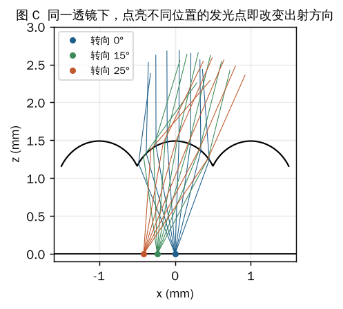
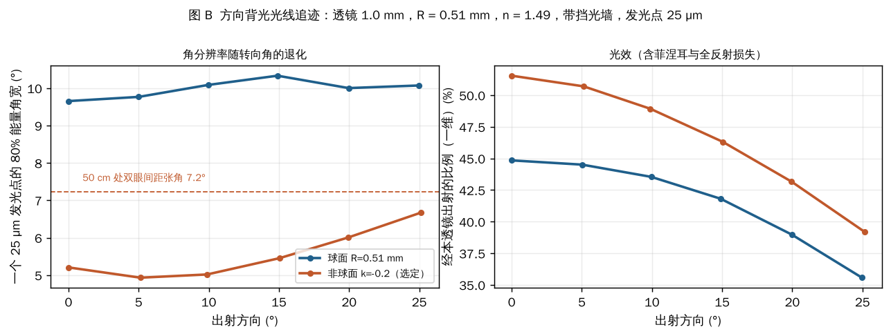

### 3.3 AETHER-1 design and power (Simulated, Estimate)

| Item | Value |
| --- | --- |
| Direction layer | 1016 ppi monochrome white OLED on LTPS, 7.4 × 10⁶ emitters (25 µm) |
| Lens array | 1.0 mm aspheric (R 0.51 mm, k −0.2) with 30 µm black baffles, slanted against pixel grids |
| Image layer | 0.1 mm-pixel colour LCD, 856 × 540, 240 Hz, 4 time slots (2 people × 2 eyes) |
| Viewing | ±25° cone, 2 viewers, float 0–40 mm (43 mm limit at 40 cm) |
| Emitter peak luminance | ~18,500 cd/m² for 250 cd/m² viewed |

| Power item | W |
| --- | --- |
| Direction emission (white OLED) | 0.013 |
| Direction LTPS drive (7.4 M, 240 Hz) | 0.30 |
| Colour LCD + drive (240 Hz, no backlight) | 0.25 |
| Two global-shutter IR cameras + IR LED | 0.30 |
| SoC: eye/hand tracking + 4-view render | 0.70 |
| Wi-Fi / Bluetooth | 0.15 |
| Conversion loss (~12 %) | 0.21 |
| **Total** | **1.92 W**; 3 mm battery 9 Wh → ~4.7 h; skin rise ~13 K |

Charter v1.0 BOM estimate was US$91–144 at 100k units (corrected to US$98–158 in v1.1, below).

---

## 4. Stage 3 (24 Oct): attacking five bottlenecks

Script: `simulations/aether_physics_steps.py` → `results_steps.json`, figures `st*`. The founder asked us to "conquer the physics step by step, using existing principles or new ones."

### 4.1 S1 float height: Theorem 4, the focus-cue window (Derived, Simulated)

For the eye to *focus* on a floating point, at least N = 2 thin beams from different card positions must pass through P and land separately in the pupil (D = 4 mm). With beam pitch p on the card and geometric divergence δ:

- **A (geometry):** p ≤ D·h / [N(d − h)]
- **B (separability):** p + λd/p + dδ ≤ D/N

Combining gives the lowest height with true focus cues, **h_min = N·d·p / (D + N·p)**. Condition B is an étendue limit: each beam's 1D étendue p·δ + λ must stay around 0.7–1.3 µm, i.e. ~1.3–2.3 wavelengths, so beams must be **nearly single-mode** (spatially, not temporally, coherent).

| d | p | h_min (focus cues start) | Max δ | Beam at pupil |
| --- | --- | --- | --- | --- |
| 300 mm | 0.15 mm | 20.9 mm | 2.5 mrad | 1.25 mm |
| 400 mm | 0.15 mm | 27.9 mm | 0.96 mrad | 1.62 mm |
| 400 mm | 0.20 mm | 36.4 mm | 1.75 mrad | 1.30 mm |
| 500 mm | 0.20 mm | 45.5 mm | 0.85 mrad | 1.57 mm |

At 40 cm with p = 0.15–0.2 mm, focus cues begin at 28–36 mm, overlapping Theorem 3's 43 mm. **No gap.** Above that, float is limited only by the aperture cone (generalised to an object of radius r):

$$h \le \frac{W/2 - r}{\tan\theta}:\quad r=5\,\mathrm{mm}: 125 / 82 / 60\ \mathrm{mm}\ \text{at}\ 10° / 15° / 20°;\quad r=10\,\mathrm{mm}: 96 / 63 / 47\ \mathrm{mm}$$

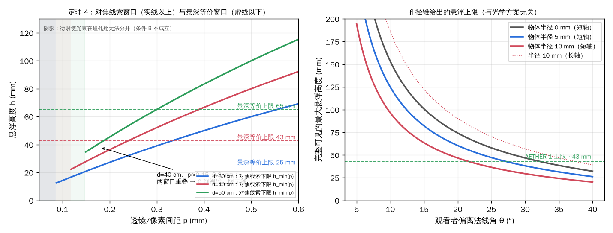

A 1D retina simulation at 40 cm confirmed it: a voxel at 60 mm (2.94 D) is focused at 2.50 D by per-eye rays but at 2.85 D by pupil-split Maxwellian viewing, leaving 0.09 D inside the depth of field. **Cost found in the v1.1 review:** the beam fills only 1/6–1/10 of the pupil, so retinal illuminance requires 6–10× more emitter radiance; only microLED can supply it.

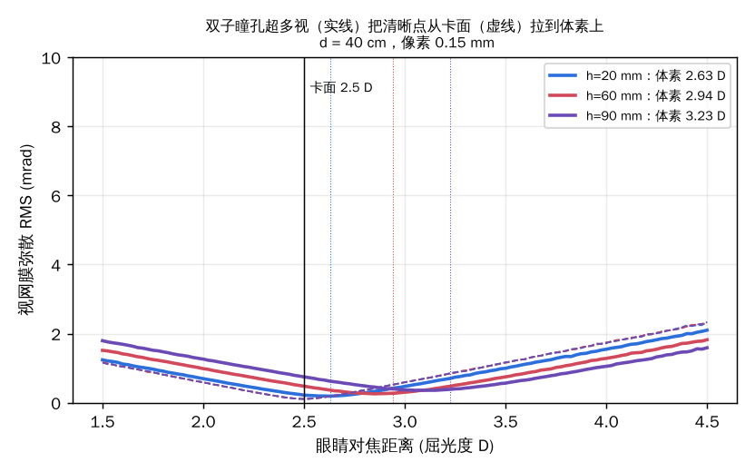

### 4.2 S2 view angle: global bias × local lenslets (Simulated)

Two liquid-crystal polarization gratings (Λ = 2.6 µm and 1.3 µm) plus a fast ferroelectric half-wave plate give four global bias directions (sin θ = ±0.21, ±0.63). Each lenslet then only covers its local ±12°. Grating dispersion is cancelled by choosing, per colour, a different emitter under each lens.

| Configuration | Max half-angle |
| --- | --- |
| Gen-1 lens (4.9°) + white colour filter (60 nm) | ±41° |
| Gen-1 lens + quantum dots (30 nm) | ±50° |
| Doublet lens (3.0°) + quantum dots | ±62° |
| Doublet lens + microLED (20 nm) | ±64° |

Efficiency: 0.95 per grating stage × 2 × 0.98 half-wave plate = 0.87; 1 % zero-order leak per stage. With the card lying flat, a 5 mm object can still float 38 / 22 / 15 mm (short axis) at 30° / 45° / 55°.

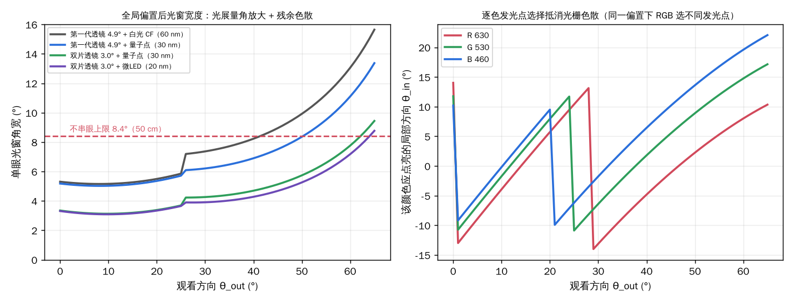

### 4.3 S3 brightness, contrast and outdoors (Simulated)

Because light goes only to pupils, the light field enjoys an "étendue dividend" of ~286× over a normal screen, but the emitter *peak* still has to be ~74× the viewed luminance (time slots, rolling strobe, optics losses). Direction-preserving polarization recycling recovers ×1.6–1.72.

| Scene | Target | Ambient contrast ratio | Emitter peak (no recycle → with recycle) | OLED (< 25k) | microLED (< 10⁶) |
| --- | --- | --- | --- | --- | --- |
| Indoor 500 lx | 250 cd/m² | 315 | 18.5k → 11.6k | Yes | Yes |
| Bright indoor 10 klx | 600 | 39 | 44k → 28k | No | Yes |
| Overcast 30 klx | 1200 | 26 | 89k → 56k | No | Yes |
| Direct sun 100 klx | 2000 | 14 | 148k → 93k | No | Yes |

Emission power stays tiny (0.013 W OLED at 250 nits; 0.27 W microLED at 2000 nits). **Outdoor use needs microLED.**

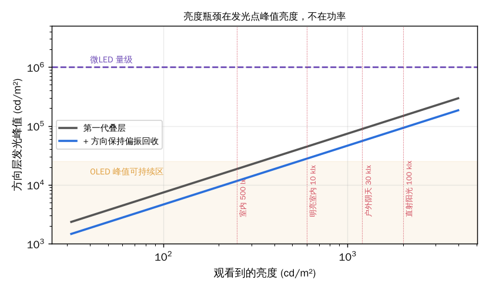

### 4.4 S4 viewers: Theorem 5, degrees-of-freedom conservation (Derived)

Each eye needs its own image of P_view pixels at ≥ 60 Hz. The direction layer only decides *who* receives light; it creates no new image content. Hence

$$N_{eyes} \le \frac{\sum_k DOF_k\, f_k}{P_{view}\cdot f_{min}}$$

| Image modulator | Eyes | People |
| --- | --- | --- |
| LCD 240 Hz (Gen-1) | 4 | 2 |
| Fast LCD 480 Hz | 8 | 4 |
| Two LCDs, factorised, 240 Hz | 8 | 4 |
| Two LCDs, 480 Hz | 16 | 8 |
| Ferroelectric LC, 3 kHz bit-planes (8-bit) | 6 | 3 |
| Direct-emissive light field (Gen-3) | limited by power, not DOF | — |

Turning on Theorem 4's focus mode costs two slots per eye, halving the count. Sony's 60 Hz SR2 serving one person (its "two-person mode" alternates) is exactly this theorem at f = 60 Hz.

### 4.5 S5 power and heat closure (Simulated)

| Case | Power | vs 2.15 W limit (15 K) |
| --- | --- | --- |
| Gen-1 | 1.92 W | OK |
| Gen-2 indoor (microLED direction layer, 480 Hz LCD, PG half-wave plates, wide IR cameras, 8-view render) | 2.19 W | Over |
| Gen-2 outdoor | 2.45 W | Over |
| Gen-2 adaptive (≤ 2 viewers) | 1.96 W | OK |
| Sunlight absorbed outdoors | +4.16 W | Thermal mass 54 J/K buys minutes only |

**Conclusion of stage 3:** engineering can move inside the limits (angle ±50–62°, float 63–82 mm, 4 viewers), but **no new physics beats the generalised aperture theorem.**

### 4.6 Charter v1.1 corrections (25 Oct, re-audit)

- The fast LCD (OCB class, ≤ 1.5 ms) became mandatory for Gen-1 (found in stage 4).
- With the rolling strobe, the OLED peak rises to 28.9k cd/m² without recycling, so polarization recycling is **required** (→ ~18k).
- BOM corrected from US$90–135 to **US$98–158**; battery 7–9 Wh, 3.6–4.7 h; stack 9.1 mm; thermal limit 2.2 W (the 2.15 W figure was a rounded-down constant).
- Gen-3 changed: the old 1.5 × 10⁸-emitter wafer light field (p = 0.5 mm) gives h_min = 80 mm and fails condition B, so it provides **no usable focus cues**. Gen-3 became pupil-split Maxwellian viewing with 2–3 µm near-single-mode microLED emitters (still ~7.4 M).
- Metasurface lenses demoted to a back-up (broadband efficiency and dispersion unsolved); the aperture theorem also shows a metasurface cannot image outside the cone.

---

## 5. Stage 4 (24 Oct): our laws against Looking Glass and Sony

Details and sources: `references/AETHER_References.md` §2. This is the physics part only.

| AETHER law | What the products show | Verdict |
| --- | --- | --- |
| Light-field blur grows with distance from the panel | Looking Glass Go: 54°/66 views ≈ 0.82° per view, eye sees ~5 views (~4°); with 0.315 mm lens pitch, blur ≈ 1 mm at 10 mm and ≈ 2 mm at 24 mm out of the screen. Vendor tells creators to keep the subject on the zero-parallax plane | Confirmed; untracked lenticulars have only ~±1 cm sharp depth |
| Aperture cone | Sony keeps content inside a "view space" box and vignettes the edges | Confirmed (their box is our cone) |
| Theorem 5 | Sony 60 Hz serves 1 person; SR2's 2-person mode alternates | Confirmed exactly |
| Static multiview resolution = panel pixels / views | Go: 3.69 MP / 66 ≈ 56k px per view; reviews note softness | Confirmed; a card has half Go's area, so static multiview would be blurrier |
| Theorems 3–4 comfort window | Both focus at the panel and publish no pop-out depth | Confirmed |
| Brightness limited by emitter peak | Sony 400–500 nits, recommends dim rooms | Confirmed |
| Apparent counter-example: high-index block makes images "float" | A slab of thickness t and index n shifts the image only t(1 − 1/n): ~1 mm for 3 mm acrylic. The rest is psychological cues | Not a counter-example |

**New risk found:** 240 Hz with 4 slots leaves 4.17 ms per slot; Sony's 14 ms LCD cannot settle in time, so AETHER-1 needs a fast OCB/FLC LCD.

---

## 6. Stage 5 (25 Oct): the card phone and the reciprocal aperture (v2.0–v2.4)

Script: `simulations/aether_v2_sim.py` → `results_v2.json`, figures `v2_f1`–`v2_f6`.

**The founder's seven requirements:** remove the infrared cameras and keep one opening only; broadcast to everyone by default with an optional private mode; viewable from any angle (no 50° stand); replace the phone at bank-card thickness; redesign power and cooling (not phone-style); add audio and typing; adjustable brightness; run Android and other OSes; "think of a structure nobody has thought of".

**Key idea (Derived):** light paths are reversible (Helmholtz reciprocity). If emitters and photodiodes share each microlens, the ray leaving in a direction and the ray returning from it are the same ray. The display becomes its own camera and touch sensor.

### 6.1 Theorem 2 re-read: "visible if the aperture is not blocked"

The founder's wording is exactly the aperture cone. For an 84 × 52 mm bezel-less aperture and a 5 mm object, the short-axis float limit is **78 / 36 / 21 / 12 / 5.6 mm at 15° / 30° / 45° / 60° / 75°**. Small holes fail badly:

| Aperture | Directions that fully see a 5 / 10 / 20 / 40 mm float |
| --- | --- |
| 84 × 52 mm (v2.1) | 82.6 / 67.2 / 43.9 / 20.4 % |
| 76 × 44 mm (v2.0) | 79.3 / 61.6 / 37.3 / 16.0 % |
| Ø10 mm hole | 21.3 / 6.9 / 1.9 / 0.5 % |
| Ø3 mm hole | 2.7 / 0.7 / 0.2 / 0 % |

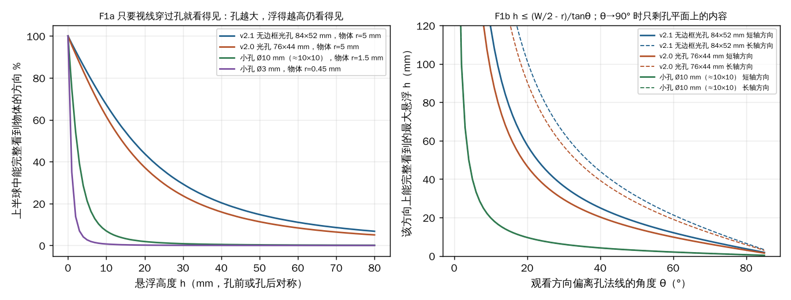

### 6.2 Theorem 5′: viewers of a direct-emissive light field

With k × k emitters under each lens aimed at k × k directions and no LCD, different eyes use different emitters simultaneously:

$$N_{eyes} \le k^2/4\ \text{per bias state (each eye takes about } 2\times2 \text{ directions)}$$

Ω-1 (k = 37.5): ~350 eyes. The cost moves to emitter count: total emitters = aperture area / e², independent of lens size (Ω-1: 2.73 × 10⁸, ~12× the pixels of a Vision Pro's two micro-OLEDs).

### 6.3 Theorem 6: broadcast depth–angle trade-off

Untracked, each emitter beam spreads Δθ ≈ e/f. A voxel at height h blurs as max(p, hΔθ), so

$$h^* = p/\Delta\theta,\qquad d_{stereo} = IPD/\Delta\theta$$

| | p | e | f | Δθ | Sharp depth h* | Blur at 20 / 40 mm | Stereo to |
| --- | --- | --- | --- | --- | --- | --- | --- |
| Ω-1 | 0.15 mm | 4 µm | 0.15 mm | 1.53° | ±5.6 mm | 0.53 / 1.07 mm | 2.4 m |
| Ω-2 (ISO) | 0.12 mm | 3 µm | 0.12 mm | 1.43° | ±4.8 mm | 0.50 / 1.00 mm | 2.5 m |

Making broadcast sharp at 20 mm needs Δθ ≈ 0.43°, i.e. 1.1 µm emitters and 3.6 × 10⁹ of them: beyond manufacturability. **Detected viewers get per-eye sharpening** (0.15 mm, float to 43 mm), provided two people's eyes are not in the same 10.7 mm beam at 40 cm.

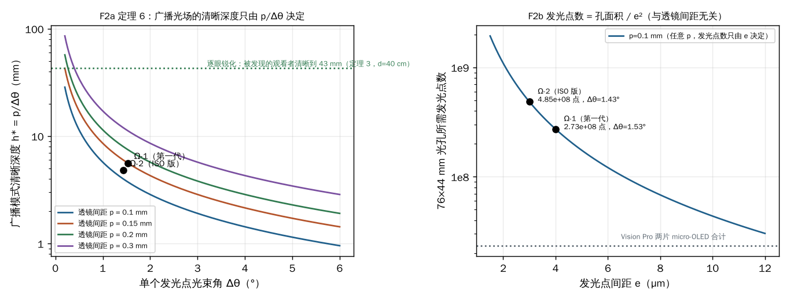

### 6.4 Theorem 7: reciprocal visibility

(a) **Finding viewers without a camera.** Display light entering a pupil is retro-reflected by the retina ("red-eye") back into the same lenses. Coding a small kHz modulation into the display light and lock-in detecting it finds every pupil looking at the card:

$$\mathrm{SNR} \propto L\cdot A_{aperture}\cdot m / d^2$$

| Condition (estimated parameters: 6 % retinal return, 30 % capture, 15 % detector fill, 33 ms) | 0.3 m | 0.5 m | 1.0 m | 2.0 m |
| --- | --- | --- | --- | --- |
| Indoor 250 cd/m², 10 % modulation | 135 | 49 | 12 | 3.0 |
| 3 % modulation (less visible) | 41 | 15 | 3.7 | 0.9 |
| Dark room | 424 | 154 | 39 | 9.6 |
| Outdoor, display 1500 cd/m² | 128 | 46 | 12 | 2.9 |

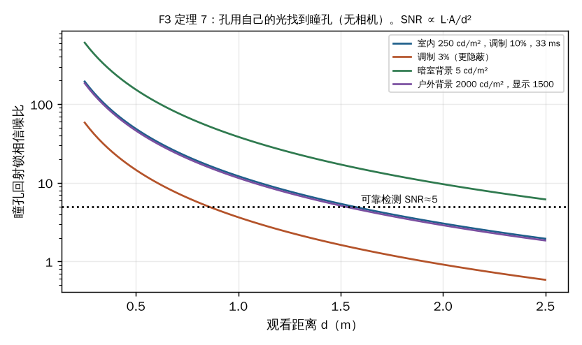

(b) **Zero-error finger registration.** A floating voxel is the crossing of specific rays; a finger there blocks or reflects exactly those rays, seen by detectors under the same lenses. Display and sensor coordinates are aligned lithographically (sub-micron). Estimated depth resolution at 30 mm: ~0.07 mm with an 84 mm baseline.

(c) **Privacy is symmetric:** private mode lights only emitters aimed at the owner's pupils.

### 6.5 Theorem 8: energy–thickness law

$$E_{battery} = \rho_V\cdot A\cdot t\quad (A \approx 80\times49\ \mathrm{mm})$$

An ISO card leaves ~0.3 mm for a cell: at 350 Wh/L (solid-state, ~2030 estimate) that is **0.41 Wh**, vs ~2.3–2.4 Wh/day modelled use. (Today's 0.42 mm Renata CP042350: 28 mAh × 3 V ≈ 174 Wh/L.)

### 6.6 Theorem 9: ambient power flux (why "no battery" cannot be reliable)

$$\sum_i S_i A_i \eta_i \ge P_{mode}$$

| Source (card receiving area ~40–46 cm²) | Power | Note |
| --- | --- | --- |
| Body heat (hand) | 0.2 mW | |
| Urban RF background | ~nW | |
| Indoor 500 lx, perovskite PV | 2.3 mW | |
| Office 2000 lx PV (38.7 % record cell) | 10 mW | |
| Outdoor sun, back PV, half the time facing up | 0.49 W | |
| Far-field RF at ICNIRP public limit 10 W/m², 50 % rectifier | 23 mW | Safety-capped |
| Room-scale quasistatic cavity resonator (U-Tokyo 2021: ~5 W to a phone) | ~1 W | Card flat coil, estimate |
| Infrared power beaming (Wi-Charge class) | ~1 W | Line of sight |
| Contact magnetic resonance pad | 5 W | |

| Mode (Estimate) | Power |
| --- | --- |
| Sleep (backscatter notifications) | 0.4 mW |
| Standby (eDRX cellular) | 4 mW |
| Minimal private (text) | 82 mW |
| Private 2D/3D | 0.35 W |
| Shared 2D | 0.51 W |
| Shared 3D broadcast | 1.03 W |
| Cellular call | 0.38 W |

**Derived conclusions:** in nature only sunlight can drive the display; indoor light and safe RF only cover standby; reliable indoor use needs a near-field or beamed artificial power source. A 10 J supercapacitor buffer lasts 10–130 s of display.

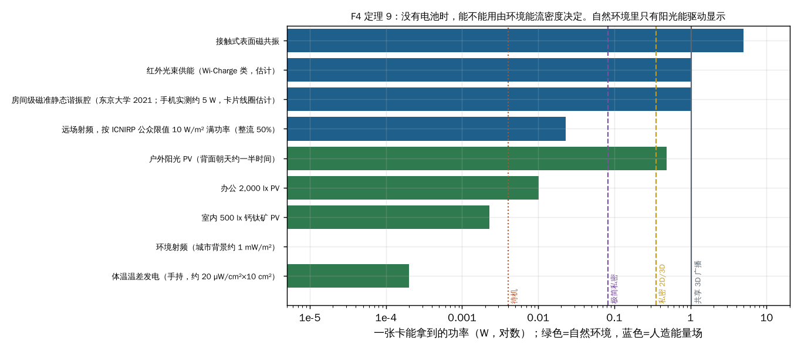

### 6.7 Theorem 10: thin-card camera law

Resolvable pixels are limited by sensor size (∝ focal length f) and the diffraction spot 1.22λF, while f ≤ L/1.25 for optical track L:

$$N_{eff} \approx \frac{W}{1.22\lambda F}\cdot\frac{H}{1.22\lambda F},\quad W,H\propto f \le L/1.25\ \Rightarrow\ N_{eff}\propto L^2$$

| Card thickness | Optical track L | f | Effective pixels | Video |
| --- | --- | --- | --- | --- |
| 3.0 mm | 2.6 mm | 2.1 mm | ~3.7 MP | 1440p30 |
| 2.4 mm | 2.0 mm | — | ~2.2 MP | 1080p |
| 2.0 mm | 1.6 mm | — | ~1.4 MP | 720–1080p |
| Phone main camera | 6–9 mm | — | 12–50 MP | 4K |
| Aperture itself as camera (0.15 mm lenses, λ/p ≈ 0.21°) | — | — | ≤ 0.3 MP | — |

### 6.8 Projection onto surfaces (Ω-3, Simulated)

| Emitter | Pixel at 10 / 30 / 100 cm | Pixels across 200 mm at 30 cm |
| --- | --- | --- |
| Ω-1 (4 µm, f 0.15 mm) | 2.7 / 8.0 / 26.7 mm | 25 |
| Near-single-mode 0.5 µm | 0.37 / 1.1 / 3.7 mm | 181 |
| + 4 × 4 coherent lens combining (research) | 0.6 / 0.6 / 0.92 mm | 333 |

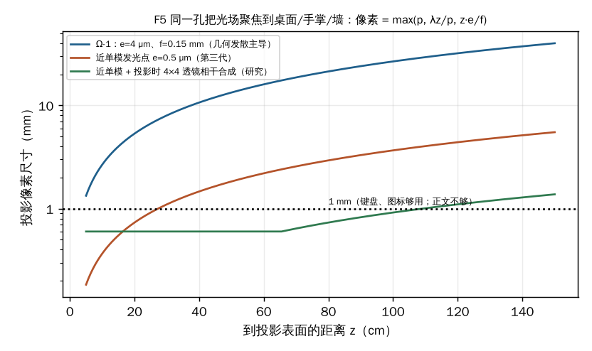

### 6.9 Aperture improvements (Simulated)

Float limit is proportional to aperture width, so the only levers are a larger or additional aperture.

| Aperture | 15° | 30° | 45° | 60° |
| --- | --- | --- | --- | --- |
| Single card 84 × 52, short axis | 78 mm | 36 mm | 21 mm | 12 mm |
| Single card, long axis | 138 | 64 | 37 | 21 |
| Two cards side by side 170 × 52, long axis | 299 | 139 | 80 | 46 |
| Four cards 2 × 2, 170 × 106, short axis | 179 | 83 | 48 | 28 |

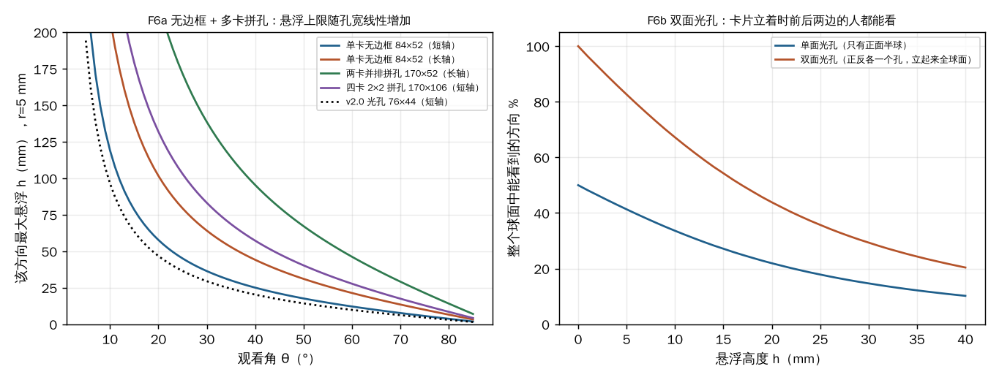

### 6.10 How the v2 numbers evolved (energy and thickness decisions)

| Version | Change (founder's request) | Physics consequence |
| --- | --- | --- |
| v2.0 | One opening, reciprocal aperture 76 × 44 mm | Ω-1 1.6 mm, 1.5 Wh (~65 % of a day) |
| v2.1 | "No battery at all; physics doesn't forbid it" | Theorem 9 written; 10 J supercap; 1.0 mm card; works only under sun or power nodes |
| v2.2 | "I want reliable energy" → chose 2 mm battery + charging sleeve | 1.2 mm pouch, 2.8 Wh, ~1.2 days (×2 power → ~14 h); 15 Wh sleeve |
| v2.3 | Keep 2 mm, battery 1.0 mm (2.35 Wh); asked about battery ageing | ~1 day (×2 → 12 h); ~1 cycle/day like a phone, 80 % after ~3–4 y with sleeve-based shallow cycling |
| v2.4 | Front and back identical apertures; 3 mm, extra thickness to battery | 1.55 mm pouch ≈ 3.6 Wh: ~1.5 days (×2 → ~18 h), private 10.4 h, shared 3D 3.5 h, standby 38 d; sleeve ~3 recharges; total ~6 days; in-window cameras ~3.7 MP |

**Thermal note:** a 3 mm card sheds ~1.16 W at 10 K and ~1.73 W at 15 K. If real power is double the estimate, shared 3D (2.06 W) overheats regardless of battery size.

**Why stage 5 ended:** after v2.4 the founder asked whether a smaller aperture would lower cost; the answer (resolution unchanged, float scales with width) made it clear the device is a light-field *screen*. The founder: "This is not holographic projection, it is a screen." See the decision log for costs.

---

## 7. Stage 6 (25 Oct): a human-size image in the room

The founder clarified the target: a small device projecting a near-human-size image into the room ("ring to person" was a ratio; the device stays a bank card), seen by everyone, touchable, at low cost, and "don't tell me physics limits; find new theory".

### 7.1 Three walls, each restated as an assumption to break

| Wall | Number | Hidden assumption |
| --- | --- | --- |
| Field of view ≈ aperture / distance | A card at 40 cm spans ~12° | Light must come from the device |
| Air must hold matter | Theorem 1 | The air stays passive |
| Card heat ~1.2 W | A human-size image at room brightness needs tens of watts | Power must be in the card |

### 7.2 Directions explored and why each was dropped

| Direction | Physics (summary) | Numbers | Why dropped |
| --- | --- | --- | --- |
| Ring + eyewear (misread brief) | Near-eye optics give a 1.7 m virtual figure | — | Founder: the device is a bank card, "ring" was only a ratio; no glasses |
| **AETHER Mist** | Palm-size base makes sparse mist containing a photoswitchable dye; a UV light sheet sweeps ≥ 30 Hz and activates one layer; the card's visible projector makes only activated droplets fluoresce → true 360° volume | Card $138–225 + base $25–50 (est.); base supplies 20–40 W; prior art Patel *Nat. Chem.* 2017, xolography *Nature* 2020 (**Unverified**) | Founder rejected dye in the air (inhalation, investor acceptance) |
| **AETHER Column** | Pure-water mist column with closed-loop recapture; 5–20 µm droplets scatter forward in a 5–10° lobe, so each viewer sees only the beam entering from the opposite side; a high-speed DLP + spinning mirror sends 24–36 azimuth views → 360° horizontal parallax; NIR camera for touch | Desk base ~12 cm: figure 30–50 cm, 20–50 lm, 5–10 W, kit $196–335. Floor base ~30 cm: figure 1.2–1.7 m, 300–800 lm, 30–60 W, kit $263–450. Mist efficiency ~15–40 % of a white wall (est.). Prior art Yagi 2011, Jones 2007 | Founder: nothing may be sprayed into the air, not even water |
| Transparent-film aerial image | Retro-reflective / lens film re-images the card into the air | Image size ≈ film size | A screen in disguise; known technology |
| Femtosecond air plasma (as a product) | Stage 1 numbers | Laser tens of thousands of dollars (est.) | Known, unsafe, noisy, expensive |

**Outcome:** a project rule, *nothing may be released into the air*, plus *no "Qing-dynasty" (already-known) ideas*. With class 1 (matter at P) forbidden and class 2 (aperture images) rejected as screens, we stated plainly that no known fourth mechanism existed and offered to write a "research bounty" for one. The founder then supplied the industry definition of true holography (wavefront reconstruction by interference and diffraction; Pepper's ghost, film, mist, spinning mirrors and plasma are not holography) and asked us to go back to first principles.

---

## 8. Stage 7 (25 Oct, current): true holography from the wave equation

Script: `simulations/aether_holography_v3.py` → `results_v3.json`, figures `v3_*` (written on 26 Oct to reproduce the stage-7 numbers; the derivations themselves were done on 25 Oct).

**Three starting facts only:**

1. Light in air obeys the linear Helmholtz equation ∇²E + k²n²E = 0. Air's nonlinear index n₂ ≈ 3 × 10⁻¹⁹ cm²/W gives a correction of ~10⁻¹⁹ at 1 W/cm²: zero.
2. The eye senses only the wave entering its ~4 mm pupil. "Seeing P" means that wave is a spherical wave centred on P.
3. Energy flows along the Poynting vector S = E × H and is conserved.

### 8.1 H1: the Window Law (Derived)

Let the card be the only source, occupying area A. For any source-free region of the room, the Kirchhoff–Helmholtz integral gives the field everywhere from the field on its boundary:

$$E(\mathbf r) = \oint_{\partial V}\left[G\,\partial_{n'}E - E\,\partial_{n'}G\right]dS',\qquad G=\frac{e^{ik|\mathbf r-\mathbf r'|}}{4\pi|\mathbf r-\mathbf r'|}$$

In empty air only the card has E ≠ 0, so all light in the room is radiated by the card. To see P, light must first converge through P and then diverge into the pupil; in a linear, uniform medium that light can only have come from the card.

> **H1: in empty air, you see P only if the line from your eye through P, extended backwards, passes through the card. A true hologram is a window.** P may float in front of or behind the card, but you must look *through* the card.

| Quantity | Value | Script output |
| --- | --- | --- |
| Window at 40 cm | 12.2° × 7.7° | `H1.window_deg_at_40cm` |
| Distance for a 1.7 m figure to fit the window | ~12.6 m behind the card | `H1.figure_1p7m_behind_card_m` |
| Steering, sin θ = λ/2p at 532 nm | 3.7 µm ±4.1°; 2 µm ±7.6°; 1 µm ±15.4°; 0.5 µm ±32° | `steering_deg` |
| Card space-bandwidth product A/(λ/2)² | ~6.5 × 10¹⁰ pixels (~2000× today's ~3 × 10⁷) | `card_SBP_pixels` |

**Corollary (eye tracking):** only two eyes need light, so steer a few-millimetre viewing window onto each pupil every frame (the SeeReal approach). Pixels then need to cover a pupil, not all directions. This is the basis of the Phase 1 Holo Card.

**Relation to stage 1:** H1 is Theorem 2 restated for coherent light. Moving from rays to waves did not open the room; it confirmed the window.

### 8.2 Attacking the hidden assumptions of H1

| Hidden assumption in H1 | Attack | Result |
| --- | --- | --- |
| The direction you see equals the direction energy comes from | 1. Superoscillation | Closed |
| The hologram plate must be the device | 2. Room walls as the plate (H3) | Geometry passes, energy fails |
| Air is a passive, linear medium | 3. Make the air emit light | **The only open door** |

#### Attack 1: superoscillation (Derived, Estimate)

A band-limited wave can oscillate faster than its highest frequency over a small region (Aharonov, Berry). If the card synthesises a superoscillating patch across the pupil whose local direction points at a P outside the window, the eye would believe the light came from P.

Tilting the apparent direction by Δθ = 0.3 rad (~17°) across D = 4 mm needs

$$N_{extra} = \frac{D\,\Delta\theta}{\lambda} = \frac{4\times10^{-3}\times0.3}{0.53\times10^{-6}} \approx 2{,}260\ \text{extra cycles}$$

The energy fraction in a superoscillating region falls roughly exponentially with the number of extra oscillations, so ~e⁻²²⁶⁰ ≈ 10⁻⁹⁸³ (the prefactor is uncertain; hundreds of orders of magnitude do not change the verdict). Allowed in principle; not one photon arrives in practice. **Closed.**

#### Attack 2: the room as the hologram, and the H3 law (Derived; believed new, literature check pending)

Walls surround everyone. If the card's laser were wavefront-coded so that light scattered by rough walls converged in mid-room into the object's wave, the "window" would become the whole room. Nothing is added to the air. KAIST (*Nature Photonics* 2017) used a thin scattering layer to enlarge hologram étendue at centimetre scale; we pushed the idea to room scale.

Model the walls as lossless random scatterers: a unitary matrix T maps the card's N controllable modes to N_tot output modes, with elements approximately i.i.d. complex Gaussian of mean power 1/N_tot. Phase-conjugating all inputs onto one output gives

$$P_{focus} \approx \frac{\pi}{4}\,N\,\frac{P_{in}}{N_{tot}}$$

> **H3 (scattering-focus law): focusing efficiency η ≤ N/N_tot; image contrast C ≈ (π/4)·N/M for an M-point image.**

| Quantity (60 m² of wall, green light) | Value |
| --- | --- |
| Wall modes N_tot ≈ A/(λ/2)² | 8.5 × 10¹⁴ |
| Efficiency with a 4K phase SLM (N ≈ 8.8 × 10⁶) | 1.0 × 10⁻⁸ |
| Efficiency at the card's theoretical limit | 7.7 × 10⁻⁵ |
| Light needed for a human-size image (§8.3) | 113 lm |
| Light the card must emit | ~1.5 × 10⁶ lm (kilowatts of laser) |
| Contrast with a 4K SLM, M = 10⁵ | ~69 : 1 (adequate) |
| Laser linewidth for ~10 m path spread | < c/ΔL = 30 MHz |

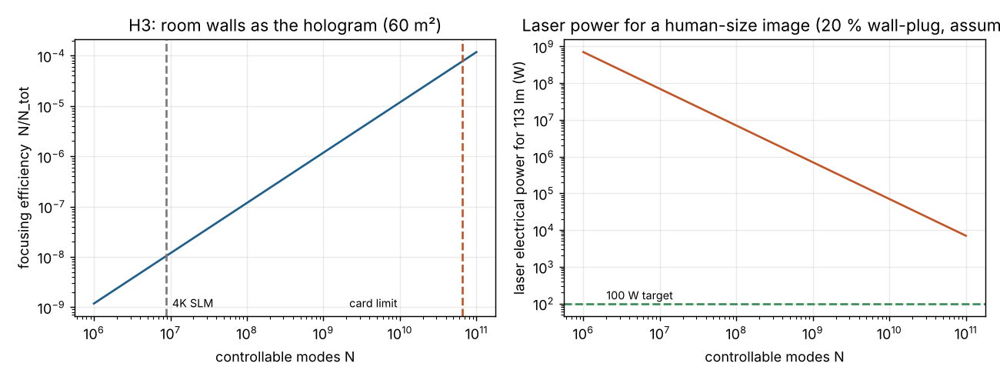

This is the only purely optical scheme that truly escapes H1 geometrically, and its contrast is fine, but it is short by ≥ 10⁴ in energy. Replacing the wall with a designed optical film would make it efficient, but that is a screen again. H3 is kept as a result in its own right (proposed bench test T2).

#### 8.3 Light budget (Derived)

Treating the image as a glowing body of luminance L and area S radiating to both sides, Φ ≈ 2πLS. With L = 30 cd/m² (comfortable in a dimmed room) and S = 0.6 m² (human silhouette), **Φ ≈ 113 lm**, about a 10 W incandescent bulb. The amount of light is small; the problem is making only the air at the image emit it.

#### Attack 3: make the air emit light

H1 and H3 hold for every linear, passive medium, so the only exit is for the air at P to generate new light (nonlinear or active emission). Air is already in the room; nothing is sprayed.

- **Known: laser plasma.** N₂ and O₂ do not absorb visible light; multiphoton ionisation needs ~10¹³–10¹⁴ W/cm². Examples: Aerial Burton, Fairy Lights (**Unverified** names/years). Crackling, ozone, eye hazard, expensive lasers.
- **Air lasing exists:** femtosecond pulses make N₂⁺ emit coherently at 391/428 nm (LOA, Shanghai teams), proving air can be a gain medium, but at the same intensities.

### 8.4 First computational screening: where exactly is the bottleneck?

| Step | Formula | Value |
| --- | --- | --- |
| Visible power | 113 lm / 683 lm/W | 0.165 W |
| Photon rate at 555 nm | P/(hc/λ) | 4.6 × 10¹⁷ s⁻¹ |
| Emitting volume | 1 mm skin × 1.2 m² (both faces) | 1.2 × 10⁻³ m³ |
| Molecules | × 2.5 × 10²⁵ m⁻³ | 3 × 10²² |
| **Photons per molecule per second** | | **1.5 × 10⁻⁵ (one emission every ~18 h)** |

**Two-photon estimate (Assumed cross-section σ₂ = 10⁻⁵³ cm⁴·s; illustrates the bottleneck, not a real transition).** Rate per molecule = σ₂F² with photon flux F = I/hν. The original 25 Oct text quoted ~6 × 10⁵ W/cm² continuous and ~2 × 10⁸ W/cm² peak when scanning 10⁵ points (≈ 5 × 10⁴ below plasma). Re-running in `aether_holography_v3.py` with a 1064 nm pump gives 2.3 × 10⁵ W/cm² and 7.3 × 10⁷ W/cm² (≈ 1.4 × 10⁵ below plasma). The difference comes from the assumed pump wavelength and rate convention; **either way the required intensity is four to five orders of magnitude below breakdown.**

> **Finding:** neither molecule count nor total light intensity is the bottleneck. The bottleneck is that N₂ and O₂ lack an energy pathway that weak light can excite and that emits visible light.

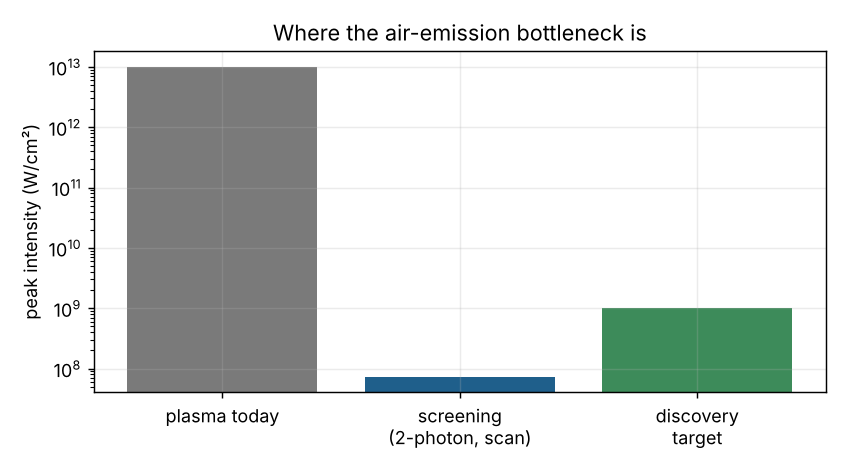

| Hypothesis | Physics | Result | Status |
| --- | --- | --- | --- |
| H-a Coherent control | Shaped pulses make multiphoton pathways interfere constructively | Typical literature enhancements: a few × to ~100×, far from 10⁴–10⁶ | Weak alone |
| H-b Metastable ladder | N₂ A³Σu⁺ lives ~2 s in vacuum: "charge" weakly, read out at P | (1) X → A is spin-forbidden, tiny optical cross-section. (2) In air, O₂ quenches A: k ≈ 2.5 × 10⁻¹² cm³/s (**Unverified**), [O₂] = 5.2 × 10¹⁸ cm⁻³ → τ ≈ 1/(k[O₂]) ≈ **77 ns**, not 2 s | Blocked by oxygen |
| H-c Two-beam crossing resonance | Two weak beams sum to a molecular resonance only where they cross | Allowed two-photon lines (e.g. N₂ a¹Πg, ~8.5 eV) need UV photons in and give vacuum UV out: not visible, not eye-safe | Wrong energy levels |

**Lead worth chasing: the aurora's red light.** The N₂ first-positive system (B³Πg → A³Σu⁺) emits 580–1000 nm (red to near-IR), the colour of aurora and red sprites. A ↔ B is an *allowed* one-photon transition that ~1 µm near-infrared light can cycle, so one molecule can emit many times. The single hard step is putting N₂ into the triplet A state weakly and locally; nature does it by electron impact (discharge), which needs ionisation.

### 8.5 Unified conclusion of stage 7

1. **Window-scale true holography is feasible** (H1 + eye tracking): the physical basis of the Phase 1 product.
2. **Room-scale true holography needs a new mechanism.** Pure optics is closed by H1, H3 and the superoscillation analysis.
3. **The mechanism's location is known:** an energy pathway in air molecules. Molecule count and total intensity are not the limit; meeting "weak, local, visible, safe" at once is.

### 8.6 Discovery target (research bounty)

Find a mechanism that makes a chosen point in air emit visible light, meeting all of:

1. **Local:** only the chosen point glows; the beams elsewhere do not (nonlinear response or two-beam crossing).
2. **Weak-light:** peak intensity ≤ 10⁸–10⁹ W/cm², 10⁴–10⁶× below today's plasma threshold.
3. **Visible:** 400–700 nm emission.
4. **Safe:** illumination safe for eyes and skin (prefer the > 1.4 µm "eye-safe" band).
5. **Efficient:** ≤ 100 W total for a human-size image.

**Research lines:** (1) a cheap route into N₂ A³Σu⁺ followed by near-IR cycling of the first-positive red band; (2) a write-then-read pulse sequence completed inside the ~77 ns anti-quench window, treating the metastable state as a very short memory; (3) the upper bound of coherent control combined with resonant intermediate states.

### 8.7 Decisive experiments (no own lab needed)

| ID | Content | Who | Cost (est.) |
| --- | --- | --- | --- |
| T1 | Compute emission yield and required intensity for the three lines from published cross-sections and rate constants | AETHER (computation) | 0 |
| T2 | H3 bench test: laser + phase SLM + 30 cm white box; check η ≈ N/N_tot | University optics lab or makerspace | US$2–5k |
| T3 | Measure visible yield for lines 1 and 3 | Partner ultrafast-laser lab | Partnership / grant |

The founder cannot run experiments or buy a prototype, so T1 (pure computation) is the next physics step, and T2/T3 depend on partners.

---

## 9. Everything we ruled out, in one table

| Mechanism | Stage | Reason (physics or founder rule) |
| --- | --- | --- |
| Clean-air Rayleigh imaging | 1 | ~106 W beam for 100 cd/m²; cannot localise a point |
| Air Raman scattering | 1 | Linear, ~1000× weaker than Rayleigh |
| Femtosecond / nanosecond air plasma | 1, 6 | ~785× Class 1 average power; noise, ozone, cost; also "already known" |
| Air two-photon fluorescence, four-wave mixing | 1 | UV transitions; breakdown-level intensities |
| Acoustic / thermal air lens | 1 | Deflection ≤ λ/Λ ≈ 10⁻⁴–10⁻³ rad |
| Electrostatic, magnetic, optical levitation | 1 | Earnshaw; 3.3 nN/W; Class 3B/4 lasers |
| Negative-index "perfect lens" slab | 2 | Image distance ≤ slab thickness (≤ 9 mm); still inside the cone |
| Card-scale coherent hologram at ±45° (no tracking) | 1, 2 | 3.3 × 10¹⁰ pixels of 0.38 µm |
| Whole-wafer 1.5 × 10⁸-emitter light field for focus | 3 | h_min = 80 mm and fails condition B |
| 1D lenticular direction layer | 2 | Vertical light wasted, ~2 W emission |
| Single fast lens + side lobes for wide angle | 3 | Lobes every ~15° leak one eye's view into another person's eye |
| Ordinary 14 ms LCD for 240 Hz multiplexing | 4 | 4.17 ms slots; crosstalk |
| Acoustic levitation inside the card | 1 | ~19 W, ~9× the heat limit (kept as dock accessory) |
| Battery-free card | 5 | Theorem 9: sleeps without sun or power nodes; not reliable |
| ISO-thickness card with battery | 5 | Theorem 8: 0.41 Wh vs ~2.4 Wh/day |
| Betavoltaic or micro fuel cell | 5 | µW-level (e.g. 100 µW class) / needs mm-thick tank and air path |
| Light-field "screen" as the product (v1–v2.4) | 5 | Founder: it is a screen, not a hologram |
| Ring + eyewear | 6 | Misread brief; device is a bank card; no glasses |
| Photoswitch-dye mist (AETHER Mist) | 6 | Founder rule: no chemicals in the air |
| Pure-water mist column (AETHER Column) | 6 | Founder rule: nothing sprayed into the air |
| Transparent-film aerial image | 6 | A screen in disguise |
| Superoscillation to fake ray direction | 7 | ~e⁻²²⁶⁰ energy fraction |
| Walls as the hologram plate (H3) | 7 | η ≤ N/N_tot: ≥ 10⁴ short in energy |
| N₂ metastable ladder (as stated) | 7 | O₂ quenching ~77 ns (rate constant unverified) |
| Two-beam resonance in N₂/O₂ | 7 | UV in, vacuum UV out |

---

## 10. Where we stand

| Statement | Status |
| --- | --- |
| Clean air cannot show a point without nonlinearity or local matter (Theorem 1) | Derived, simulated |
| Every matter-free image lies inside the aperture cone; for coherent light this is the H1 window | Derived |
| Depth-of-focus equivalence, focus-cue window, DOF conservation (Theorems 3–5) | Derived and simulated; the 0.3 D threshold should be tested on ~20 people |
| Theorems 5′–10 (reciprocal aperture, energy, camera) | Derived; retinal-return SNR and power figures are estimates (experiments X1, X5 proposed) |
| A window-scale true hologram on a card is feasible with eye tracking | Derived; Phase 1 hardware not built |
| Superoscillation workaround closed | Derived (prefactor approximate; conclusion robust) |
| H3 law and its ≥ 10⁴ energy gap | Derived; believed new; literature check and bench test T2 pending |
| Molecule count and intensity are not the bottleneck for air emission | Estimate (assumed σ₂) |
| A low-threshold, eye-safe air-emission mechanism exists | **Unproven. This is the open problem.** |
| Phase 0 AETHER Window software | Built and running on the founder's PC; it is per-eye rendering, not a true hologram |

---

## 11. Simulation index and how to reproduce

All files are in `simulations/`. Install `pip install numpy scipy matplotlib`, then run each script from inside that folder; it rewrites its JSON and figures. Comments in the four earlier scripts are in Chinese; the code and outputs are language-neutral.

| Script | Stage | What it computes | Outputs |
| --- | --- | --- | --- |
| `aether_sim.py` | 1 | Rayleigh cross-section and beam luminance (S1), plasma eye-safety ratio (S2), acoustic/thermal air grating deflection (S3), aperture-cone visibility (S4), pixel budget and data rates (S5), Gor'kov acoustic trap (S6), ultrasound absorption, light-field and bead illumination flux (S7), thermal limit (S8), acoustic power (S9) | `results.json`, `fig2_view_cone`, `fig3_lightfield_blur`, `fig4_acoustic_trap`, `fig5_us_absorption` |
| `aether_mp_sim.py` | 2 | Accommodation mismatch (Theorem 3), lenslet ray trace (spherical vs aspheric), steering accuracy and crosstalk margin, Gen-1 emitter count, power and runtime | `results_mp.json`, `mp_accommodation`, `mp_raytrace`, `mp_steering` |
| `aether_physics_steps.py` | 3 | Focus-cue window (Theorem 4), frustum float limits, 1D retina simulation, polarization-grating bias angles and efficiency, brightness/contrast table, viewer counts (Theorem 5), Gen-2 power and heat | `results_steps.json`, `st1_float_windows`, `st1_retina`, `st2_bias_steering`, `st3_brightness` |
| `aether_v2_sim.py` | 5 | Visibility vs aperture (F1), broadcast depth and emitter count (F2), retinal retro-reflection SNR (F3), mode power vs ambient sources and battery runtimes (F4), projection resolution (F5), aperture tiling (F6), Theorem 5′, touch depth | `results_v2.json`, `v2_f1`–`v2_f6` |
| `aether_holography_v3.py` | 7 | H1 window, steering vs pixel pitch, card SBP, superoscillation cost, H3 efficiency/contrast/linewidth, light budget, molecule screening, two-photon estimate, N₂(A) quench lifetime | `results_v3.json`, `v3_h3_efficiency`, `v3_screening` |

---

## 12. Open questions and the next calculations

1. **T1 screening with real data:** replace the assumed σ₂ with published cross-sections for candidate N₂/O₂ pathways; compute yield, threshold and eye-safety for research lines 1–3.
2. **Verify every Unverified number:** N₂(A) quenching constant by O₂, Vellekoop & Mosk focusing-enhancement origin, plasma-display product names and years.
3. **H3 literature check:** confirm whether the η ≤ N/N_tot room-scale bound has been published; if not, write it up.
4. **Phase 1 optics:** viewing-window steering range, SLM pixel pitch and laser safety for a card-sized eye-tracked hologram.
5. **Perception test:** confirm the 0.3 D depth-of-field threshold (Theorem 3) on real viewers using the AETHER Window demo.
